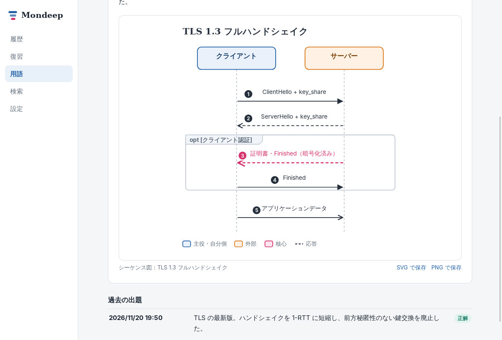
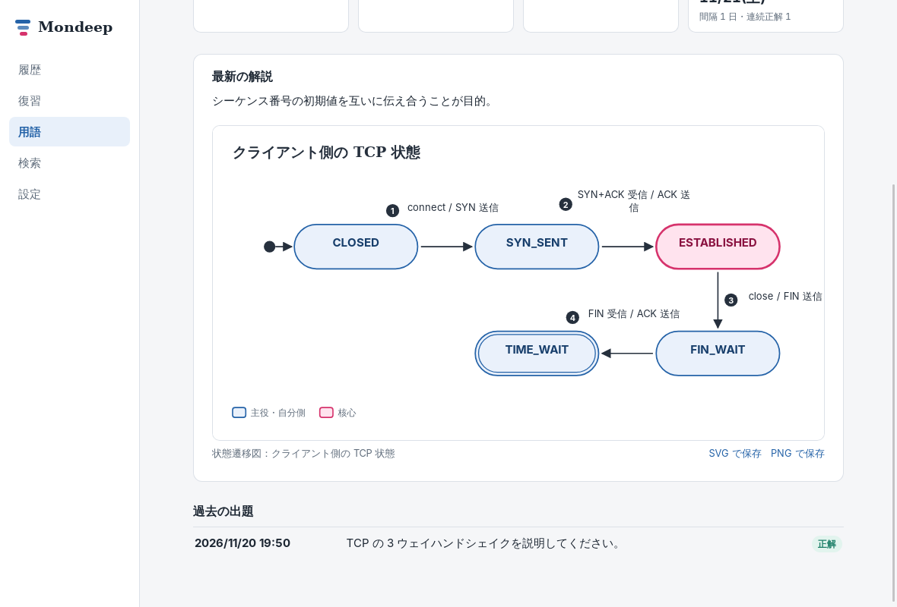

# Mondeep（モンディープ）

Claude Desktop との会話で出題・回答・深掘りを行い、その記録をローカル MCP サーバー経由で蓄積して、あとから復習するための学習支援デスクトップアプリです。
アプリは「記録・復習・解説を読む場所」で、出題と採点は Claude が担います。名前は 問答（mondo）＋ deep。


## 構成

```
Claude Desktop ──(stdio / MCP)──▶ mondeep-mcp ──┐
                                                ├──▶ mondeep.db（SQLite・WAL）
Mondeep アプリ（Tauri）─────────────────────────┘
```

| ディレクトリ | 中身 |
| --- | --- |
| `crates/mondeep-core` | 共通DB層。スキーマとマイグレーション、用語の同一判定、復習スケジュール（SM-2 簡易版）、図解データの検査、全文検索、バックアップ |
| `crates/mondeep-mcp` | MCP サーバー（公式 Rust SDK `rmcp` 3.x）。ツール 8 個とプロンプト 2 個 |
| `app/src-tauri` | Tauri アプリのバックエンド（画面から呼べるコマンドは capability で列挙したものだけ） |
| `app/src` | 画面（React + TypeScript） |
| `app/src/zukai` | 図解フレームワーク。図解データ（JSON）から SVG を組み立てる。アプリ本体に依存しない |

DB は OS 標準のアプリデータフォルダ（macOS: `~/Library/Application Support/Mondeep/mondeep.db`）に置きます。
アプリと MCP サーバーは外部と通信しません。

## 使い方

### ビルド

前提: Rust（stable）、Node.js 22、Tauri の前提ライブラリ（macOS は Xcode Command Line Tools）。

```sh
cd app && npm install && cd ..
cargo build --release -p mondeep-mcp          # MCP サーバー
cd app && npm run tauri build                 # アプリ本体（開発中は npm run tauri dev）
```

### Claude Desktop に登録する

アプリの「設定」画面で「設定をコピー」して `claude_desktop_config.json` の `mcpServers` に貼るか、「設定ファイルに追記」を押します（元のファイルは `.bak` に残します）。手で書く場合は次の形です。

```json
{
  "mcpServers": {
    "mondeep": {
      "command": "/path/to/mondeep-mcp",
      "args": ["--db", "/Users/<you>/Library/Application Support/Mondeep/mondeep.db",
               "--knowledge-path", "/path/to/knowledge-db"]
    }
  }
}
```

`--knowledge-path`（ナレッジ DB のフォルダ）と `--obsidian-vault`（Vault 名）は省略できます。指定すると出題ガイドに書かれ、Claude が素材の場所に迷わなくなります。

アプリ画面は MCP サーバーの実行ファイルを、アプリと同じフォルダにあるものとして扱います。

### 学習の流れ

1. Claude Desktop で「TLS 周りを意味→用語で 10 問」「今日の復習をやりたい」「XSS で面接形式の深掘り」のように頼む
2. Claude が `study_guide` を読み、復習対象を取得して出題・採点し、問題・回答・判定・解説・図解を保存する
3. アプリで履歴・解説・苦手一覧を見る。用語カードで「要復習の印」を付けると、次回 Claude がそれを拾う

## MCP ツール

| ツール | 役割 |
| --- | --- |
| `start_session` | セッション開始（形式・テーマ）→ セッション ID |
| `get_review_queue` | 今日復習すべき用語と過去の正誤の要約 |
| `get_term_history` | 用語の過去の出題・回答（同じ問いの繰り返しを避ける） |
| `record_question` | 問題を保存。深掘りは `parent_question_id` で木構造に。近い用語があると候補を返す |
| `record_attempt` | 回答・判定・理由・解説・図解・出典を保存 → 更新後の次回復習日 |
| `end_session` | まとめを保存 → 正答率 |
| `list_weak_terms` | 苦手用語と理由（不正解が多い・深掘りが浅い段で止まる・要復習の印） |
| `search` | 用語・問題文・解説の全文検索 |

削除系の操作は公開しません（削除はアプリ画面からのみ）。プロンプト `study_guide`（出題の進め方・判定基準・解説の書き方）と `diagram_guide`（図解データの規約と JSON Schema）で採点と解説の質をそろえます。

## 図解フレームワーク

Mermaid は使わず、Claude は「何を描くか」だけを JSON で渡します。MCP サーバーが保存前にスキーマと規約を検査し（ラベルのない矢印、要素が 9 個超、文字のはみ出し、同じマスへの重ね置き、線の交差は警告）、違反は理由つきで Claude に返します。アプリは検査済みのデータから SVG を組み立てて描き、AI が書いた SVG・HTML は表示しません。

対応している図: 概念図・シーケンス図・状態遷移図・比較表。色は 青＝主役、オレンジ＝外部、赤＝エラー系、ピンク＝核心の強調で、凡例は自動で付きます。図はクリックで拡大でき、SVG / PNG で書き出せます（ダウンロードフォルダの `Mondeep/` に保存）。

| シーケンス図 | 状態遷移図 |
| --- | --- |
|  |  |

図の種類を足すときは、`crates/mondeep-core/src/diagram.rs` に型と検査規則を、`app/src/zukai/render.ts` に描画を足します。

## 復習スケジュール

- 復習状態は「用語 × 形式」ごとに持つ（用語を答えられることと、意味を説明できることは別の力なので）
- 意味→用語は 正解 5 / 部分正解 3 / 不正解 1 を SM-2 の quality にする
- 深掘り形式は「最初の問いの判定」と「正解できた最も深い段」で quality を決める。同じ深掘りの木は 1 回の復習として数える
- 間隔は 1 日 → 3 日 → 前回 × 難易度係数（下限 1.3、最大 365 日）

## 開発

```sh
cargo test --workspace                                   # DB 層・復習計算・図解検査のテスト
python3 scripts/mcp_smoke.py target/debug/mondeep-mcp    # MCP を stdio で一通り呼ぶ
cd app && npm test                                       # 図解の描画・Markdown の安全性
python3 scripts/seed_demo.py target/debug/mondeep-mcp /tmp/demo.db
MONDEEP_DB=/tmp/demo.db npm --prefix app run tauri dev   # デモデータで画面を確かめる
```
