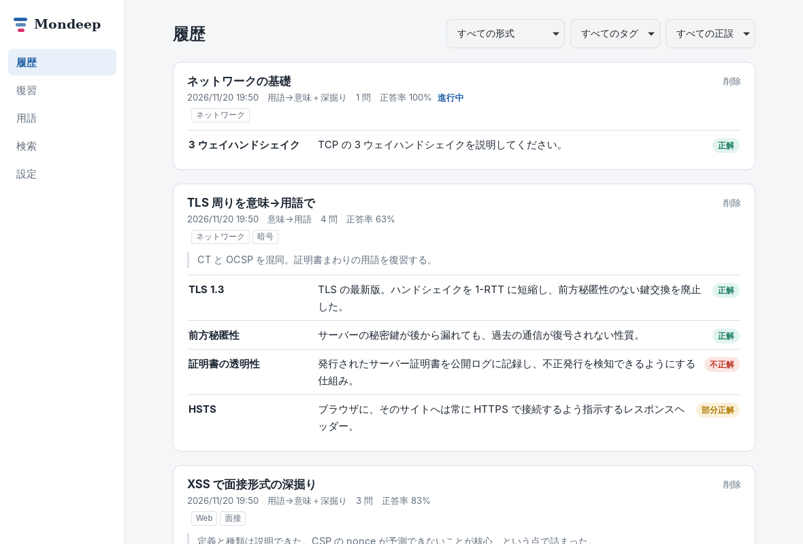
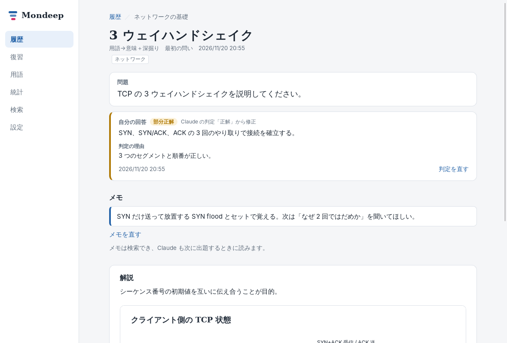
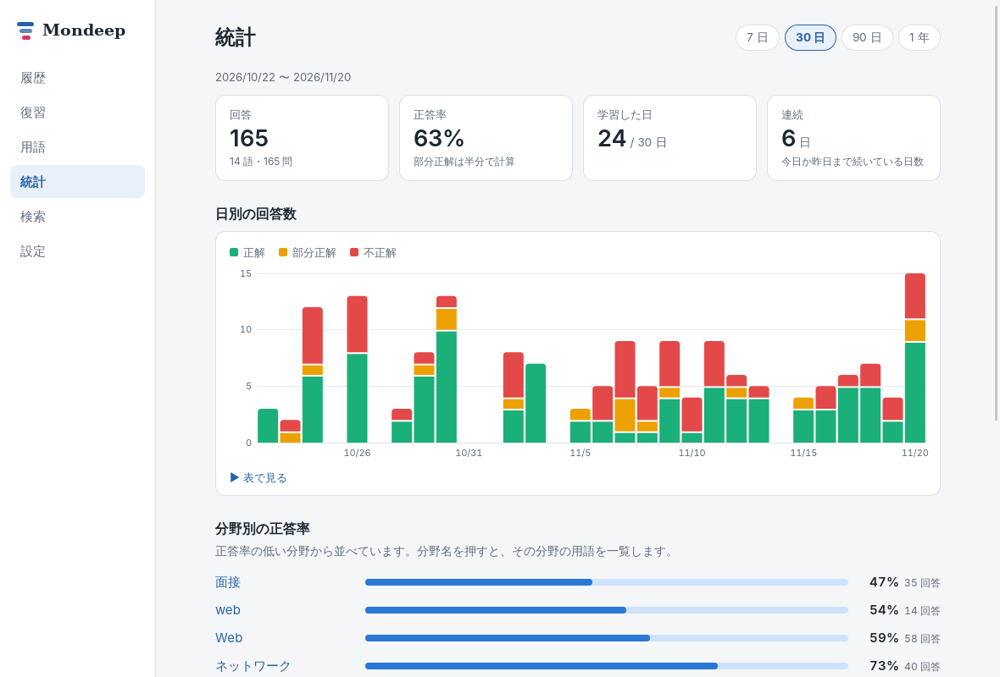
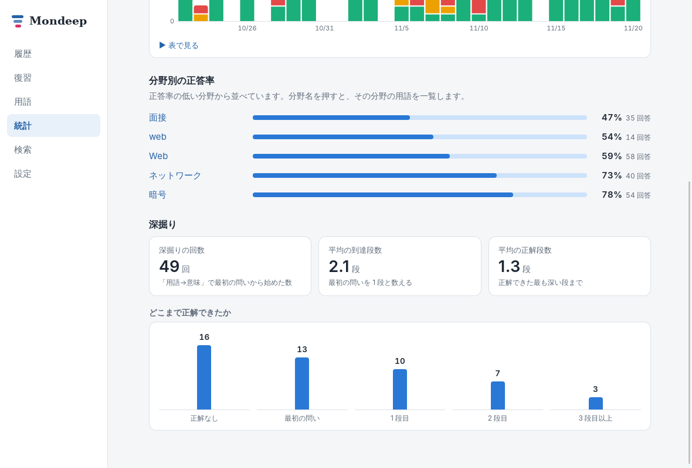

# Mondeep（モンディープ）

Claude Desktop との会話で出題・回答・深掘りを行い、その記録をローカル MCP サーバー経由で蓄積して、あとから復習するための学習支援デスクトップアプリです。
アプリは「記録・復習・解説を読む場所」で、出題と採点は Claude が担います。名前は 問答（mondo）＋ deep。



## 構成

```
Claude Desktop ──(stdio / MCP)──▶ mondeep-mcp ──┐
                                                ├──▶ mondeep.db（SQLite・WAL）
Mondeep アプリ（Tauri）─────────────────────────┘
```

| ディレクトリ | 中身 |
| --- | --- |
| `crates/mondeep-core` | 共通DB層。スキーマとマイグレーション、用語の同一判定、復習スケジュール（SM-2 簡易版）、図解データの検査、全文検索、バックアップ |
| `crates/mondeep-mcp` | MCP サーバー（公式 Rust SDK `rmcp` 3.x）。ツール 8 個とプロンプト 2 個 |
| `app/src-tauri` | Tauri アプリのバックエンド（画面から呼べるコマンドは capability で列挙したものだけ） |
| `app/src` | 画面（React + TypeScript） |
| `app/src/zukai` | 図解フレームワーク。図解データ（JSON）から SVG を組み立てる。アプリ本体に依存しない |

DB は OS 標準のアプリデータフォルダ（macOS: `~/Library/Application Support/Mondeep/mondeep.db`）に置きます。
アプリと MCP サーバーは外部と通信しません。

## 使い方

### ビルド

前提: Rust（stable）、Node.js 22、Tauri の前提ライブラリ（macOS は Xcode Command Line Tools）。

```sh
cd app && npm install
npm run bundle        # MCP サーバーを同梱した配布物（macOS は .app と .dmg）を target/release/bundle に作る
```

`npm run bundle` は MCP サーバーをリリースビルドして sidecar としてアプリに入れます（`scripts/prepare-sidecar.mjs`）。
開発中は `cargo build -p mondeep-mcp` のあと `npm run tauri dev` で起動します（`target/debug` に並んだ MCP サーバーを使います）。

macOS 版は GitHub Actions の「Bundle」ワークフローでも作られ、実行結果の Artifacts から .dmg を取れます。
署名は ad-hoc なので、初回は Finder で右クリック →「開く」で起動してください（Apple の公証は未対応）。

### Claude Desktop に登録する

アプリの「設定」画面で「設定をコピー」して `claude_desktop_config.json` の `mcpServers` に貼るか、「設定ファイルに追記」を押します（元のファイルは `.bak` に残します）。手で書く場合は次の形です。

```json
{
  "mcpServers": {
    "mondeep": {
      "command": "/path/to/mondeep-mcp",
      "args": ["--db", "/Users/<you>/Library/Application Support/Mondeep/mondeep.db",
               "--knowledge-path", "/path/to/knowledge-db"]
    }
  }
}
```

`--knowledge-path`（ナレッジ DB のフォルダ）と `--obsidian-vault`（Vault 名）は省略できます。指定すると出題ガイドに書かれ、Claude が素材の場所に迷わなくなります。

MCP サーバーはアプリに同梱され、アプリ本体と同じフォルダ（macOS: `Mondeep.app/Contents/MacOS/mondeep-mcp`）に置かれます。アプリを移動したら登録し直してください。

### 学習の流れ

1. Claude Desktop で「TLS 周りを意味→用語で 10 問」「今日の復習をやりたい」「XSS で面接形式の深掘り」のように頼む
2. Claude が `study_guide` を読み、復習対象を取得して出題・採点し、問題・回答・判定・解説・図解を保存する
3. アプリで履歴・解説・苦手一覧を見る。用語カードで「要復習の印」を付けると、次回 Claude がそれを拾う

## アプリでできること

| 画面 | できること |
| --- | --- |
| 履歴 | セッションごとの問題と判定。形式・タグ・正誤で絞り込み、セッションの削除 |
| 問題 | 問題・回答・判定の理由・深掘りのはしご・解説と図。**判定の手直し**と**メモ** |
| 復習 | 今日の復習と苦手一覧 |
| 用語 | 用語カード（正答率・次回復習・過去の出題）、タグの付け外し、要復習の印、**Obsidian 用の書き出し**。**タグの管理**画面 |
| 統計 | **日別の回答数・分野別の正答率・深掘りの平均到達段数** |
| 検索 | 用語・問題文・解説・メモの全文検索 |
| 設定 | Claude Desktop への登録、データの保存場所、**全用語の書き出しと DB のバックアップ** |

### 判定の手直しとメモ

Claude の判定に納得いかないときは、問題画面の「判定を直す」で 正解 / 部分正解 / 不正解 に直せます。Claude の元の判定は残り、「Claude の判定に戻す」でいつでも戻せます。直した問題がその用語のいちばん新しい復習なら、次回復習日も直した判定で計算し直します（それより前の復習を直した場合は、記録と正答率だけが変わります）。

問題にはメモを残せます。メモは検索の対象になり、Claude も `get_term_history` で直された判定（`original_verdict` が元の判定）と一緒に読むので、「次はこう聞いてほしい」も伝えられます。



### タグの管理

タグは Claude が保存時に付けます。「用語」→「タグを管理」で、タグの名前を変えたり（同じ名前に変えると 1 つにまとまる。「web」と「Web」のような表記ゆれの整理に）、使わなくなったタグをすべての用語から外したりできます。

### 学習統計

直近 7 日・30 日・90 日・1 年で、日別の回答数（判定ごとの積み上げ、1 年は週ごと）、分野（タグ）別の正答率、深掘りの平均到達段数と「どこまで正解できたか」の分布を見られます。日付は端末のタイムゾーンで数えます。グラフの値は「表で見る」でも確かめられます。

| 日別の回答数・分野別の正答率 | 深掘り |
| --- | --- |
|  |  |

### 書き出しとバックアップ

用語カードの「Obsidian 用に書き出す」、または設定画面の「全用語を Markdown で書き出す」で、用語ごとの Markdown ノートを書き出します。保存先はダウンロードフォルダの `Mondeep/Obsidian/` で、フォルダごと Vault にコピーすると Obsidian で開けます。

- フロントマターに別表記（`aliases`）とタグ（`tags`）
- 出題の記録（問題・回答・判定・理由・メモ）を Obsidian のコールアウトで、解説はその下に
- 図は `図解/` に SVG で書き出して `![[…]]` で埋め込む（位置の微調整も反映）
- 出典の Obsidian ノートは `[[…]]` のリンクになるので、元のノートからバックリンクでたどれる
- 全用語のときは、タグごとの目次ノート「Mondeep 用語一覧」も作る

「DB を今すぐバックアップ」は、DB 全体の一貫したコピー（`VACUUM INTO`）を `Mondeep/mondeep-backup-日時.db` に保存します。起動時の自動バックアップ（直近 7 世代）とは別に残ります。

## MCP ツール

| ツール | 役割 |
| --- | --- |
| `start_session` | セッション開始（形式・テーマ）→ セッション ID |
| `get_review_queue` | 今日復習すべき用語と過去の正誤の要約 |
| `get_term_history` | 用語の過去の出題・回答（同じ問いの繰り返しを避ける）。Nico さんが直した判定とメモも含む |
| `record_question` | 問題を保存。深掘りは `parent_question_id` で木構造に。近い用語があると候補を返す |
| `record_attempt` | 回答・判定・理由・解説・図解・出典を保存 → 更新後の次回復習日 |
| `end_session` | まとめを保存 → 正答率 |
| `list_weak_terms` | 苦手用語と理由（不正解が多い・深掘りが浅い段で止まる・要復習の印） |
| `search` | 用語・問題文・解説・メモの全文検索 |

削除系の操作は公開しません（削除はアプリ画面からのみ）。プロンプト `study_guide`（出題の進め方・判定基準・解説の書き方）と `diagram_guide`（図解データの規約と JSON Schema）で採点と解説の質をそろえます。

## 図解フレームワーク

Mermaid は使わず、Claude は「何を描くか」だけを JSON で渡します。MCP サーバーが保存前にスキーマと規約を検査し（ラベルのない矢印、要素が 9 個超、文字のはみ出し、同じマスへの重ね置き、線の交差は警告）、違反は理由つきで Claude に返します。アプリは検査済みのデータから SVG を組み立てて描き、AI が書いた SVG・HTML は表示しません。

対応している図: 概念図・シーケンス図・状態遷移図・比較表。色は 青＝主役、オレンジ＝外部、赤＝エラー系、ピンク＝核心の強調で、凡例は自動で付きます。図はクリックで拡大でき、SVG / PNG で書き出せます（ダウンロードフォルダの `Mondeep/` に保存）。

概念図と状態遷移図は、拡大画面の「位置を調整」で部品をドラッグして微調整できます。微調整は「用語 × 図の種類 × 部品 ID」ごとに保存されるので、Claude が同じ用語の図を描き直しても、同じ ID の部品には引き継がれます。「自動配置に戻す」で消せます。

| シーケンス図 | 状態遷移図 |
| --- | --- |
|  |  |

図の種類を足すときは、`crates/mondeep-core/src/diagram.rs` に型と検査規則を、`app/src/zukai/render.ts` に描画を足します。

## 復習スケジュール

- 復習状態は「用語 × 形式」ごとに持つ（用語を答えられることと、意味を説明できることは別の力なので）
- 意味→用語は 正解 5 / 部分正解 3 / 不正解 1 を SM-2 の quality にする
- 深掘り形式は「最初の問いの判定」と「正解できた最も深い段」で quality を決める。同じ深掘りの木は 1 回の復習として数える
- 間隔は 1 日 → 3 日 → 前回 × 難易度係数（下限 1.3、最大 365 日）

## 開発

```sh
cargo test --workspace                                   # DB 層・復習計算・図解検査・判定の手直し・統計・書き出しのテスト
python3 scripts/mcp_smoke.py target/debug/mondeep-mcp    # MCP を stdio で一通り呼ぶ
cd app && npm test                                       # 図解の描画・Markdown の安全性・Obsidian 書き出し・統計の計算
python3 scripts/seed_demo.py target/debug/mondeep-mcp /tmp/demo.db
MONDEEP_DB=/tmp/demo.db npm --prefix app run tauri dev   # デモデータで画面を確かめる
```
